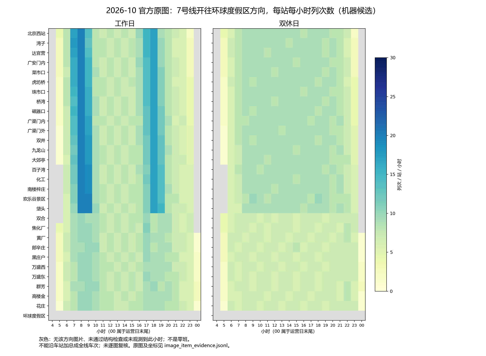

# 北京地铁时刻表存档与服务供给监测

按月保存北京地铁官方时刻表原始材料，并提供可追溯到原图的小时班次、时段供给、日型差异与首末车等统计，逐步建立可以跨期比较的服务供给记录。

**计划每月采集一次 · 保留历史快照 · 原始材料可追溯 · 二级分析与 OCR 分开**

[浏览月度存档](data/) · [首期存档与覆盖说明](data/2026/2026-10/README.md) · [首期二级分析示例](data/2026/2026-10/analysis/README.md)

## 为什么做这个项目

官方时刻表能够回答“某站、某方向、某种日型安排了多少班车”，但官网通常展示当前版本，跨月份的变化不容易回溯。只看首末车，也难以发现高峰班次、平峰密度或外围区段服务量的调整。

本项目起源于对北京地铁服务供给变化的关注：持续保存官方材料，使用固定口径统计，并把变化线索交回原图核对。随着存档积累，可以研究哪些站点、时段和方向发生了变化，变化是否持续，以及不同区段是否同步调整。对增班、减班的判断需要可比的前后期资料，项目不预设变化方向或幅度。

这是一个独立整理的数据仓库，与运营方没有隶属关系。仓库保存原始材料、整理结果、二级分析和核验说明；采集、识别、分析代码及运行缓存暂不公开。

## 数据从哪里来

来源为运营方公开发布的官方网站、接口和时刻表图片。

| 来源 | 存档材料 | 官方入口 |
| --- | --- | --- |
| 北京地铁 | 线路与车站接口 JSON、首末车信息、逐站时刻表图片 | [北京地铁官网](https://www.bjsubway.com/) |
| 北京京港地铁 | 线路时刻表 HTML、首末车及交路说明 | [列车时刻表入口](https://www.mtr.bj.cn/service/line/timetable/line-4.html) |
| 京投轨道运营 | 列车时刻表图片、首末车 HTML | [列车时刻表入口](https://www.bjmoa.cn/trainTimeList_363.html) |

各来源公开的材料形式不同，首末车信息覆盖与逐小时班次统计覆盖也可能不同。**项目面向北京地铁路网，实际覆盖以各月存档、图片索引和校验报告为准，不承诺每期均覆盖所有线路、车站、方向和日型。** 当前存档不包含第三方社区时刻表数据。

## 更新频次与历史保留

- **计划每月采集一次，原则上在月初进行。** 实际采集时间、缺失来源和处理情况记录在当月说明中；这是一项维护计划，不表示定时任务已保证按时完成。
- 每月建立独立目录，新增月份不覆盖旧月份。`YYYY-MM` 表示采集归档月份，不能直接当作时刻表的生效月份。
- 月度快照可能遗漏月内短期调整，也不能仅凭两次采集日期确定运营调整的准确发生日期。
- 新月份按统一结构加入；当月覆盖量、发现、复核情况和方法版本写入当月报告。首页仅在来源、目录或统计口径发生实质变化时更新。
- 纠错或补充通过仓库历史保留记录，并更新相应说明与校验清单。跨期比较需要检查方法版本及统计口径是否可比。

## 仓库包含什么

```text
data/
└── YYYY/
    └── YYYY-MM/
        ├── README.md       # 本期来源、采集时间、覆盖与限制
        ├── raw/            # 官方原始 JSON、HTML、时刻表图片
        ├── processed/      # 结构化整理、图片索引、OCR 候选与核对队列
        └── analysis/       # 直接基于原始材料的二级分析
            ├── README.md   # 本期分析结果与解释
            ├── figures/    # 统计图表（按本期实际产出）
            └── …           # CSV、JSONL、核验报告与结果清单
```

| 数据层 | 内容与用途 | 使用时需要注意 |
| --- | --- | --- |
| `raw/` 原始材料 | 查阅官方原文、核对图片、重做统计和版本比较 | 官方材料也可能有空字段、特殊交路或临时安排，需要结合原文解释 |
| `processed/` 整理结果 | 首末车结构化记录、图片与元数据索引、OCR 分钟表、原始文件哈希及核对队列 | OCR 尚未完成逐项纠错，不能直接视为已确认的完整运行图 |
| `analysis/` 二级分析 | 小时与时段统计、日型和区段对比、标记候选、首末车跨度、坐标证据及复核报告 | 图像统计包含机器候选与诊断记录，应结合状态和复核说明筛选 |

## 二级分析数据

二级分析直接读取 `raw/` 的官方 JSON、HTML 和原始图片，**不以未纠错的 OCR 分钟表为输入**。图片统计识别小时标签与分钟项的占位数量，不逐项转录分钟数字；这减少了对分钟 OCR 的依赖，但仍可能因版式、标记或图像质量产生错误。

| 分析内容 | 主要结果文件（位于各月 `analysis/`） | 可以回答的问题 |
| --- | --- | --- |
| 逐小时列次数 | `hourly_counts.csv` | 某站、方向、日型在每个小时安排多少列次？ |
| 全天与固定时段供给 | `station_periods.csv` | 早峰、晚峰、平峰和夜间服务量如何分布？ |
| 高频服务形态 | `station_summary.jsonl` | 峰值在哪些小时？达到每小时 12／15／20 班的时段有多少？高峰与平峰相差多少？ |
| 工作日与双休日对比 | `day_type_comparison.jsonl` | 同站同方向的工作日与双休日服务量差异多大？ |
| 站点与区段差异 | `spatial_comparison.jsonl`、`representative_sections.jsonl` | 同一方向各站供给是否均衡？指定代表站之间有多大差异？ |
| 相邻站检查 | `adjacent_station_checks.jsonl` | 相邻站同一小时的差异是否值得进一步对图检查？ |
| 颜色标记与小交路候选 | `color_markers.jsonl` | 图片上的亮色填充项有多少？已核对的单图图例对应哪些交路？ |
| 首末车与服务跨度 | `first_last_service.jsonl` | 官方公布的首末车是什么？同一记录的服务跨度有多长？ |
| 跨期版本变化 | `version_events.jsonl` | 有可比历史时，原图或小时数量是否发生变化？ |
| 原图证据与复核 | `image_catalog.jsonl`、`image_item_evidence.jsonl`、`review_queue.jsonl` | 统计来自哪张图、哪个位置？哪些记录仍需检查？ |
| 核验与完整性 | `validation.json`、`sample_review.json`（如有）、`result_manifest.jsonl` | 本期覆盖与检查情况如何？结果文件是否与校验清单一致？ |

### 固定统计口径

基本统计单位为“**车站 × 方向 × 日型 × 小时**”。列次数表示时刻表中经过该站的服务条目，同一列车可能出现在多个车站，不能把各站数量相加当作全线开行列车总数。

| 时段 | 时间范围 |
| --- | --- |
| 早峰 | 07:00–09:00 |
| 平峰 | 10:00–16:00 |
| 晚峰 | 17:00–19:00 |
| 夜间 | 21:00–次日 01:00 |

所有区间左闭右开；跨午夜的 00 时桶按运营日第 24 小时处理。高频小时数只在已观测的 06:00–23:00 整点小时范围内统计。日型比为工作日数量除以双休日数量；高峰／平峰比按各时段平均每小时列次数计算。

全天与时段数量汇总已提取的小时行，使用前应检查相关小时是否齐全。**缺失不等于零**：未提供、未解析或未通过检查的记录不能当作没有班车；明确观察到的空小时行才可以记作零。无法计算的比值保留为空值。

首末车跨度按同一记录的末班减首班计算，并处理跨午夜；不同终到站或交路保留为不同记录。`60 ÷ 小时列次数` 仅是频率换算值，不能代表实际班次间隔的分布。

## 可以拿来做什么

- **长期供给监测**：积累可比月份后，跟踪同站同方向的高峰、平峰、夜间与全天列次数，寻找持续增减的线索。
- **日型与空间比较**：比较工作日和双休日、代表站与外围站，识别服务差异集中在哪些时段。
- **首末车研究**：观察服务时段延长或缩短，保留不同终到站的末班安排。
- **图表与研究材料**：制作逐站小时热力图、月度趋势图、专题报告，并为结论附上原图证据。
- **数据核查与独立复算**：利用原始材料、图片坐标、SHA-256 和复核队列，定位错误或采用自己的方法重做分析。

以下是固定基线样例，展示图表形式；后续月份的图表见对应月份目录。



*图中为时刻表服务条目计数的机器候选值，灰色区域表示缺失、未观测或未通过检查，不能解释为零班次。*

## 如何使用与判断结果

1. 从 [月度存档目录](data/) 选择月份，先阅读该月 `README.md` 与 `analysis/README.md`，确认采集时间、覆盖、方法版本和限制。
2. 使用 `hourly_counts.csv`、`station_periods.csv` 做常规统计，使用 JSONL 文件读取更完整的元数据、状态和来源。JSONL 每行是一个独立 JSON 对象；CSV 可用于表格软件。
3. 将汇总、诊断候选与通过检查的记录区别处理。日型和区段比较只纳入满足自动结构与元数据要求的记录；部分基础输出仍保留待复核记录。
4. 对值得关注的差异，沿记录中的原图相对路径、SHA-256 和坐标回到原图，核对小时行、日型、方向与图例。
5. 做跨期研究时，对齐车站、方向、日型、时间窗口和版本；将原图变化、统计变化与确认的运营调整分开记录。

图片记录中的原图相对路径以该月 `data/YYYY/YYYY-MM/` 为基准。原始材料哈希见 `processed/sha256_manifest.jsonl`，二级分析文件哈希见 `analysis/result_manifest.jsonl`。引用结果时建议注明存档月份、采集时间、文件名、统计口径及原图哈希；机器候选或尚未复核的结论应保留相应说明。

## 结果的边界

**自动结构检查通过和固定样本通过，不等于全量人工核对，也不代表已经测得某个准确率。** 图片计数、小时识别、方向和日型匹配均可能出错，覆盖与复核程度以各月报告为准。

这些数据描述官方公布的时刻表安排，不能直接推导实际到站表现、准点率、客流、拥挤程度或载客容量。相邻站同一小时的差异也可能来自跨小时运行、始发终到、折返或越站，不能单独证明减班或小交路。

颜色与交路的对应必须绑定单张图片及其版本。同一种颜色在不同图例中可能含义不同；未核对图例的颜色不作统一交路解释，未标记项也不自动等于全程车。

项目从 2026-10 建立首期基线。仅有一期时无法计算历史增减、环比或同比；无历史基线导致版本事件文件为空，也不能解释为“没有调整”。之后是否足以确认变化，取决于可比材料与复核结果。

历史存档适合研究与核查。实际出行请以运营方当前公告和现场信息为准。

## 维护与反馈

新增一期时，归档官方原始材料、整理结果及当期二级分析，记录实际采集时间、缺失项、核验结果与方法版本，再检查差异。覆盖量与新发现集中在月度说明中，避免首页随每次采集反复改写。

发现错漏时，欢迎通过仓库 Issue 提供月份、线路、车站、方向、日型、相关文件及原图位置；若涉及统计值或交路解释，请尽量附上原图依据。未完成复核的反馈作为待核对线索保留，确认后再修订相关结果。

官方时刻表原始内容由对应运营方发布，相关权利归原权利人。本仓库不另行授予这些官方材料的数据许可；使用或再分发前请查阅来源方的相关声明。
